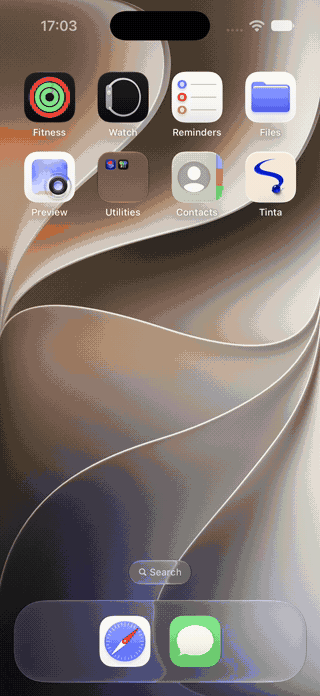

<p align="center"></p>
<h1 align="center">Tinta</h1>
<p align="center">A little ink studio. Move the bead. Leave a mark.</p>
<p align="center">NativeScript-Vue 3 · <a href="https://jolt.rafaelaugusto.dev/">Jolt RC.11</a> · iOS</p>

A bead of ink rolls over a sheet of paper, leaving lines and small splashes behind. Let it follow its own path, drag it around, or tilt your iPhone. Pick an ink, change the line width, and export the result as a PNG.

The app runs locally. There is no account, server or upload. This first version targets iOS.

<p align="center"></p>
<p align="center"><a href="docs/media/tinta-ios.mp4">Watch the iOS capture</a></p>

## Run

Use macOS, Node 22, the NativeScript CLI, Xcode and CocoaPods. The project uses NativeScript CLI 9.1.

```sh
git clone https://github.com/rafaelaugustos/tinta-ns.git
cd tinta-ns
nvm use
npm ci
npm run ios
```

To select a simulator, use `npm run ios -- --device <udid>`. List simulators with `xcrun simctl list devices available`; list physical iPhones with `xcrun devicectl list devices`. For a phone, use `npm run ios -- --device <udid> --release --team-id <team-id>` with your Apple development team.

## In the studio

- The live readout shows canvas UI callback FPS and whole-process RSS in MiB. It refreshes once a second; a paused canvas reports 0 FPS. This is not a GPU presentation counter.
- **Flow** moves the bead along a repeating path.
- **Touch** lets you drag anywhere on the paper. On the simulator, click and drag with the mouse.
- **Tilt** uses the device's gravity sensor. It requires a physical device; use Flow or Touch on the simulator.
- Tap **1×** beside undo to cycle through 1×, 1.5×, 2× and 3×. It changes Flow playback, Tilt acceleration and Touch response without speeding up the interface.
- The four inks and three widths affect new marks. Existing ink stays on the sheet.
- Pause holds the bead in place. Undo restores the state before the last touch stroke or clear; only one undo image is retained.
- Export opens the iOS share sheet with the drawing as a PNG.

## Rendering and motion

The studio interface is NativeScript-Vue. Jolt drives the bead as well as the opening, controls, icons and transitions. The app imports the main package, `gestures`, `physics`, `sensors` and `shapes`.

| Part | Implementation |
| --- | --- |
| Flow | The original curve's smoothing is solved ahead of time and passed to Jolt as native keyframes. A short entrance joins a closed, repeating path. |
| Touch | A Jolt gesture surface feeds two native spring values bound to the bead's position. Release velocity carries into a bounded landing. |
| Tilt | Jolt's gravity sensor supplies impulses to a one-body physics world. Jolt integrates motion and handles the paper's walls. |
| Bead | Jolt gradient, vector highlight and contact spring, inside a NativeScript view with a shadow. |
| Interface | Jolt timelines, spring transitions, press feedback, vector icons, motion scopes and Reduce Motion handling. |

A small native contact observer supplies the initial absolute touch position, which RC.11's gesture values do not expose. It calls JavaScript once per contact. Pan updates and spring following stay native. Tilt sends sensor impulses through JavaScript at about 30 Hz; there is no JavaScript drawing loop.

Permanent ink lives in a retained Core Graphics bitmap, capped at 2× display scale. A native `CADisplayLink` reads the bead's presentation position and paints each segment. It no longer computes the bead's movement. The displayed image is replaced after a drawing update, previous images are released, and undo retains one image. Stroke count does not grow a list of paths or snapshots.

Movement changes stroke width, and a seeded generator adds small splashes. Export reads the same bitmap. Backgrounding pauses motion and drawing; a settled Touch stroke stops the paint clock. Reduce Motion starts the studio paused and suppresses decorative entrance movement.

Jolt's iOS shapes already use Core Graphics paths and Core Animation layers. The remaining bitmap painter handles accumulation, undo and PNG export; converting every permanent mark into an animated view would add resources without helping this drawing model.

```text
src/
  canvas/          Jolt motion/input, bitmap wrapper and vector icons
  components/      Studio controls, opening and render lab
  domain/          Flow curve, inks, modes and render-report validation
App_Resources/
  iOS/src/         Bitmap painter, contact observer and offscreen memory probe
scripts/           Native build runner, icon export and benchmark runner
benchmarks/        Protocol and measured results
```

## Memory checks

The flask button opens a render lab. It runs 450 offscreen renders with changing pixels, blur and a moving rectangle, then checks the output and reports settled process RSS growth. This Core Image probe is separate from the drawing canvas.

The workload was inspired by the [tgfx offscreen autorelease fix](https://github.com/margelo/react-native-tgfx/pull/19). It is useful for checking Tinta's resource lifetime, but uses a different renderer and is not a direct performance comparison with tgfx or React Native. The supplied app clip and the tgfx 450-render regression are also different workloads.

[Measured results](benchmarks/RESULTS.md) include the simulator and physical iPhone runs, failure controls and drawing cadence. [Protocol and reproduction commands](benchmarks/PROTOCOL.md) describe warmup, readback, pixel assertions, memory accounting and the no-blur failure control. A separate 30-second run records the canvas's UI callback cadence; that number is not GPU presentation FPS.

```sh
npm run typecheck
npm test
npm run build:ios
npm run benchmark -- <udid> --runs 3
```

## Artwork

The app icon is generated artwork. Its [source](resources/tinta-icon.png) and [prompt](resources/icon-prompt.txt) are included. `npm run icons` rebuilds the iOS icons and launch image with ImageMagick. The drawing canvas and its marks are rendered by the app.
