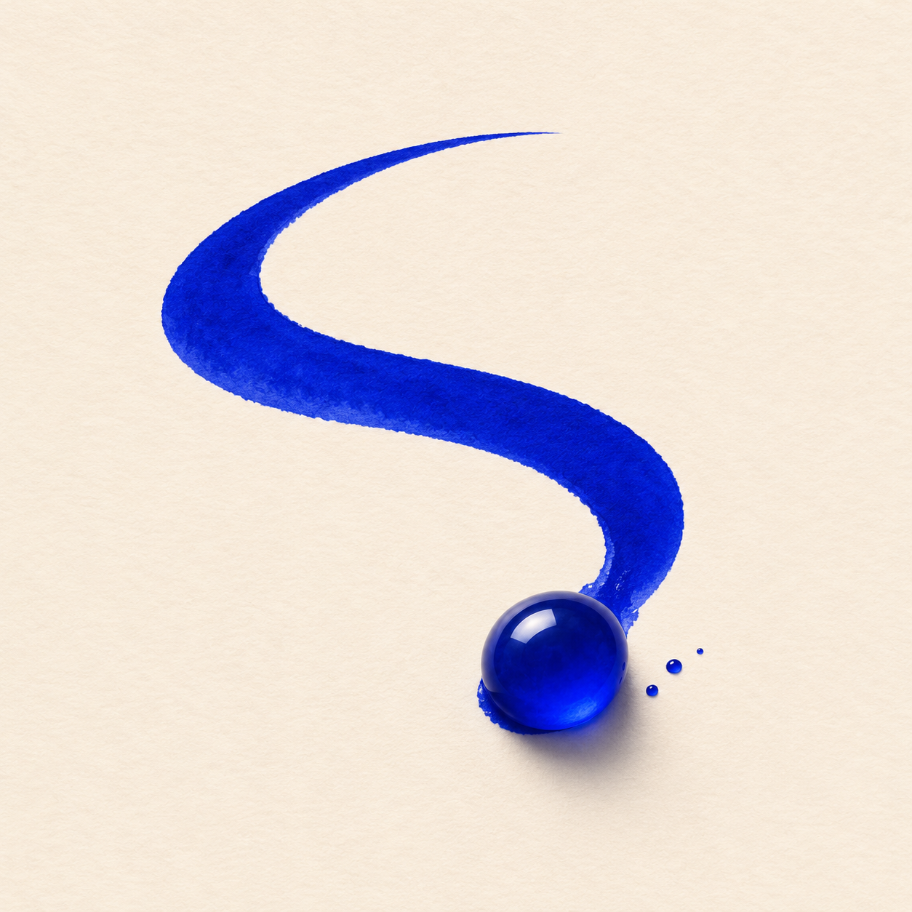

<p align="center"></p>
<h1 align="center">Tinta</h1>
<p align="center">A little ink studio. Move the bead. Leave a mark.</p>
<p align="center">NativeScript-Vue 3 · <a href="https://jolt.rafaelaugusto.dev/">Jolt RC.11</a> · iOS</p>

A bead of ink rolls over a sheet of paper, leaving lines and small splashes behind. Let it follow its own path, drag it around, or tilt your iPhone. Pick an ink, change the line width, and export the result as a PNG.

The app runs locally. There is no account, server or upload. This first version targets iOS.

## Run

Use macOS, Node 22, the NativeScript CLI, Xcode and CocoaPods. The project uses NativeScript CLI 9.1.

```sh
git clone https://github.com/rafaelaugustos/tinta-ns.git
cd tinta-ns
nvm use
npm ci
npm run ios
```

To select a simulator, use `npm run ios -- --device <udid>`. List available devices with `xcrun simctl list devices available`.

## In the studio

- **Flow** moves the bead along a repeating path.
- **Touch** lets you drag anywhere on the paper. On the simulator, click and drag with the mouse.
- **Tilt** uses the device's gravity sensor. It requires a physical device; use Flow or Touch on the simulator.
- The four inks and three widths affect new marks. Existing ink stays on the sheet.
- Pause holds the bead in place. Undo restores the state before the last touch stroke or clear; only one undo image is retained.
- Export opens the iOS share sheet with the drawing as a PNG.

## Rendering and motion

The studio interface is NativeScript-Vue. Jolt handles the opening timeline, control feedback, interface transitions, vector icons and gravity-sensor input. Sensor readings cross into the canvas at most about 30 times per second. No JavaScript frame loop draws the ink.

The canvas is a small native `UIView`. A `CADisplayLink` advances the bead and paints into a retained Core Graphics bitmap, capped at 2× display scale. The displayed image is replaced after a drawing update; previous frame images are released. Undo retains one image. The drawing does not keep an ever-growing list of paths or render snapshots.

Flow and touch input share the same painter. Movement changes the stroke width, and a seeded generator adds small splashes. The bead uses native gradient and shadow layers. Backgrounding pauses drawing; Reduce Motion starts the studio paused and suppresses decorative entrance movement.

```text
src/
  canvas/          Native canvas wrapper and Jolt icons
  components/      Studio controls, opening and render lab
  composables/     Jolt gravity sensor lifecycle
  domain/          Inks, modes and render-report validation
App_Resources/
  iOS/src/         Native painter and offscreen memory probe
scripts/           Native build runner, icon export and benchmark runner
benchmarks/        Protocol and measured results
```

## Memory checks

The flask button opens a render lab. It runs 450 offscreen renders with changing pixels, blur and a moving rectangle, then checks the output and reports settled process RSS growth. This Core Image probe is separate from the drawing canvas.

The workload was inspired by the [tgfx offscreen autorelease fix](https://github.com/margelo/react-native-tgfx/pull/19). It is useful for checking Tinta's resource lifetime, but uses a different renderer and is not a direct performance comparison with tgfx or React Native. The supplied app clip and the tgfx 450-render regression are also different workloads.

[Protocol and reproduction commands](benchmarks/PROTOCOL.md) describe warmup, readback, pixel assertions, memory accounting and the no-blur failure control. A separate 30-second run records the canvas's UI callback cadence; that number is not GPU presentation FPS.

```sh
npm run typecheck
npm test
npm run build:ios
npm run benchmark -- <udid> --runs 3
```

## Artwork

The app icon is generated artwork. Its [source](resources/tinta-icon.png) and [prompt](resources/icon-prompt.txt) are included. `npm run icons` rebuilds the iOS icons and launch image with ImageMagick. The drawing canvas and its marks are rendered by the app.
